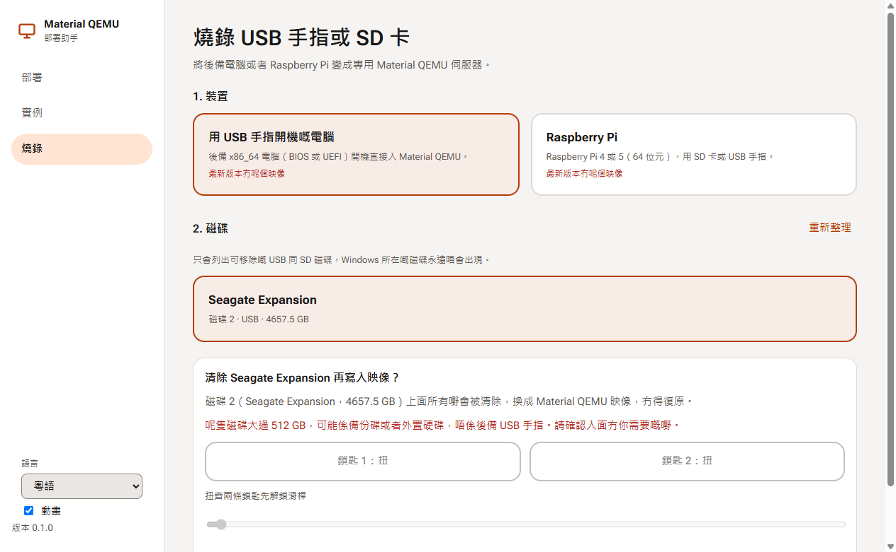
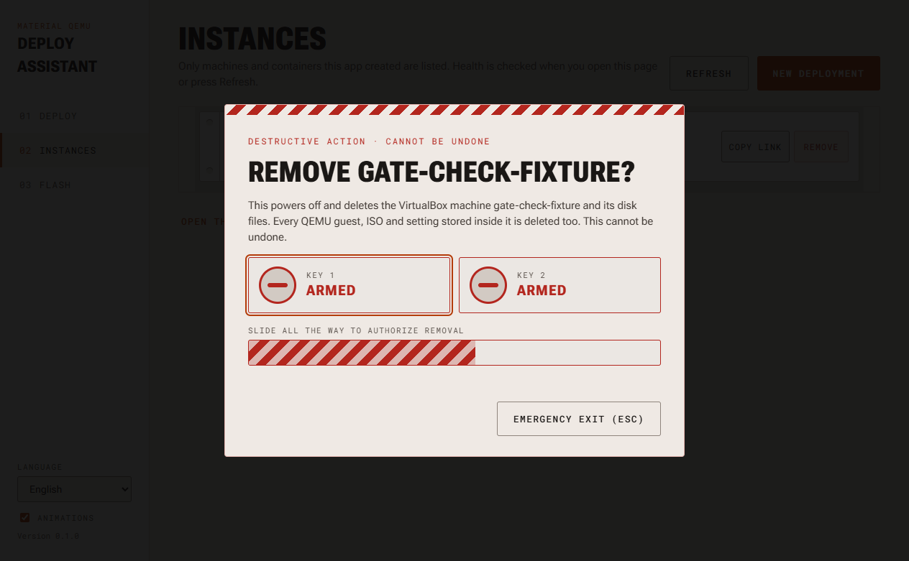
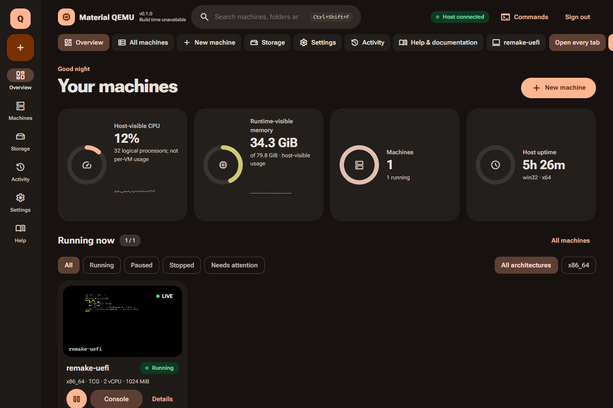
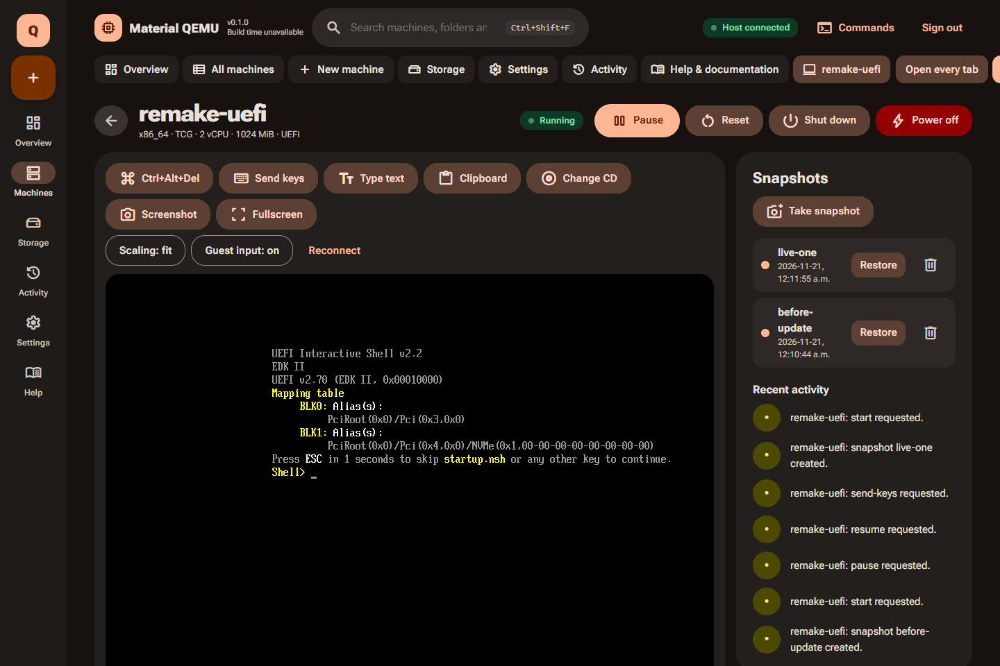

# Material QEMU

A functional, self-hosted QEMU workspace based on the preserved design contract. This initial runtime connects owner sign-in, guided setup, overview, machine management, an eight-step machine editor, and an authenticated live VNC console.

[Public screenshot gallery: current verified views and historical originals](https://ding-ding-projects.github.io/material-qemu-gallery/)

## Run locally

Use Node.js 22 or newer for the web runtime. The container includes QEMU for x86_64 and aarch64 with TCG emulation.

```powershell
.\build.bat -Container
.\host.bat --detached
```

Open http://localhost:8080/ and create the first account: the first account created becomes the owner, and every later visitor has to sign in. Set it up right after starting it, before anyone else on your network opens the page.

The default Compose port is loopback-only. Remote access requires a reviewed HTTPS reverse proxy and an exact `PUBLIC_ORIGIN`. LAN delivery and image-registry publication are not yet verified. Preserve the data volume during updates.

## One-click test host on this computer

`go-host.bat` runs Material QEMU directly on Windows for quick testing, with no container and no virtual machine. Double-click it, or run it from a terminal:

```powershell
.\go-host.bat
```

It installs QEMU for Windows through Chocolatey when it is missing (Windows asks for administrator approval), builds the runtime, starts the server on port 8090 at this computer's LAN address, waits for `/health`, and prints the link. Open it and create the first account to become the owner. `go-host.bat --status` and `go-host.bat --stop` check and stop it; `--port` and `--ip` override the defaults. Test data lives in `Documents\Material QEMU VMs\go-test`, separate from every other deployment, and is kept when it stops.

This is a test bench, not the appliance: guests use software emulation, the Arm targets report their firmware as unavailable on Windows, and a result here says nothing about the OVA or USB images.

## Host in VirtualBox, VMware, Docker or on a USB drive

Each release from the build workflow carries a portable Windows deploy assistant (`material-qemu-deploy-<version>-portable.exe`), an appliance VM (`material-qemu-appliance-<version>.ova`), and a USB image for spare Intel or AMD PCs. Run the assistant and pick a target:

- **VirtualBox or VMware Workstation**: it imports the appliance, bridges it onto your network, waits for it to report its address, checks its health, then shows the LAN link.
- **Docker on this computer**: it runs the release container on a port of this computer's LAN address.
- **Flash**: it writes the PC image to a removable USB or SD disk behind a two-key slider gate, then reads the disk back to verify it.

The **Instances** page starts, stops, restarts and removes what it created. The interface is in English, Cantonese, or both. See [hosting with the deploy assistant](docs/features/vm-hosting.md).






The assistant screens were designed first on a canvas; the source boards are in `design/deploy-assistant/`.

## Runtime behavior

- Password authentication uses scrypt; sessions use opaque HttpOnly SameSite cookies and CSRF verification.
- Passkeys use SimpleWebAuthn with origin and relying-party checks. Hardware authenticator verification remains pending.
- Machine disks are sparse QCOW2 images within managed storage. Installation ISOs are operator-managed under `data/media`.
- Machine start, pause, resume, ACPI shutdown and explicit power off use real QEMU processes and QMP.
- The browser console uses locally bundled noVNC through an authenticated WebSocket proxy. VNC and QMP bind only to container loopback.
- The data directory and container are a single-owner trust boundary. Other code running inside that container must be trusted.
- Host measurements are actual readings. Unsupported disk/network throughput and advanced hardware are not synthesized.

## Scope and remaining work

The other 50 design boards remain design-only. The deploy assistant, the appliance OVA and the USB image build in the workflow (Intel and AMD only; Raspberry Pi is out of scope); see the [roadmap](ROADMAP.md) for which of them have been verified on real hypervisors and hardware. The web app was remade in Material Design 3 with UEFI and Secure Boot firmware, CPU topology and models, multiple disks on virtio, SATA, NVMe, SCSI or IDE, network models and port forwards, display, sound, USB, serial and RNG devices, boot order, autostart, live pause, resume, reset, key and CD actions, screenshots, snapshots, and a storage manager with resize, clone and disk import ([QEMU hardware](docs/features/qemu-hardware.md), [interface](docs/features/interface.md)). TPM (swtpm) start-up, KVM, an installed guest OS, migration and native installers are not verified or not delivered. Full required-feature parity, regex tooling, complete translation and production hardening remain incomplete. `build-installer.bat` reports that gap with a nonzero exit code.

See [roadmap](ROADMAP.md), [handoff](HANDOFF.md), [runtime architecture](docs/features/runtime.md) and the original [design contract](design/HANDOFF.md). Design frames illustrate the reference only and are not runtime evidence.

## Verified runtime images

These images come from the Material Design 3 web app running natively on Windows with QEMU 11.1, driving a real UEFI machine with a virtio system disk and an NVMe data disk. Headless Microsoft Edge captured them at 1440 by 960 and 375 by 812 pixels. The [evidence inventory](evidence/README.md) records the details and limitations; earlier container images are kept there with their provenance.






