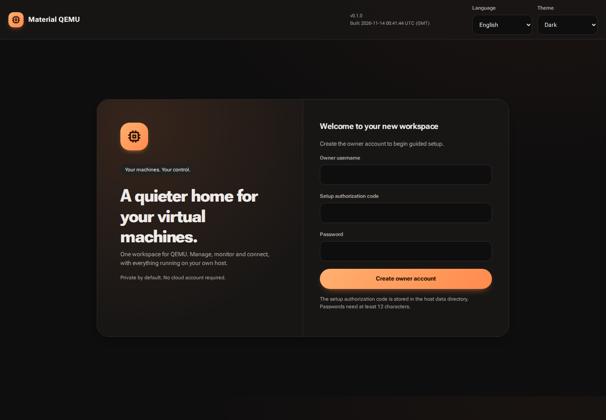
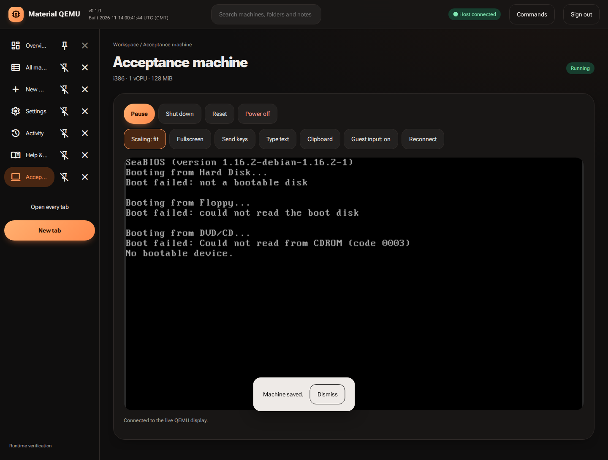

# Material QEMU

A functional, self-hosted QEMU workspace based on the preserved design contract. This initial runtime connects owner sign-in, guided setup, overview, machine management, an eight-step machine editor, and an authenticated live VNC console.

[Public screenshot gallery: current verified views and historical originals](https://ding-ding-projects.github.io/material-qemu-gallery/)

## Run locally

Use Node.js 22 or newer for the web runtime. The container includes QEMU for x86_64 and aarch64 with TCG emulation.

```powershell
.\build.bat -Container
.\host.bat --detached
```

Open http://localhost:8080/. Initial ownership requires the protected `setup-code` file in the persistent data directory. Read that file through your trusted host administration channel and enter it only in the setup form. Never publish or log it. It is removed after successful ownership setup.

The default Compose port is loopback-only. Remote access requires a reviewed HTTPS reverse proxy and an exact `PUBLIC_ORIGIN`. LAN delivery and image-registry publication are not yet verified. Preserve the data volume during updates.

## Host in VirtualBox or VMware

Each release from the build workflow carries a portable Windows deploy assistant (`material-qemu-deploy-<version>-portable.exe`) and an appliance VM (`material-qemu-appliance-<version>.ova`). Run the assistant, pick VirtualBox or VMware Workstation, and select **Deploy**: it imports the appliance, bridges it onto your network, waits for it to report its address and checks its health, then shows the LAN link and first-run setup code. Its **Instances** page starts, stops, restarts and removes the VMs it created. See [VirtualBox and VMware hosting](docs/features/vm-hosting.md).


The assistant screens were designed first on a canvas; the source boards are in `design/deploy-assistant/`.

## Runtime behavior

- Password authentication uses scrypt; sessions use opaque HttpOnly SameSite cookies and CSRF verification.
- Passkeys use SimpleWebAuthn with origin and relying-party checks. Hardware authenticator verification remains pending.
- Machine disks are sparse QCOW2 images within managed storage. Installation ISOs are operator-managed under `data/media`.
- Machine start, pause, resume, ACPI shutdown and explicit power off use real QEMU processes and QMP.
- The browser console uses locally bundled noVNC through an authenticated WebSocket proxy. VNC and QMP bind only to container loopback.
- The data directory and container are a single-owner trust boundary. Other code running inside that container must be trusted.
- Host measurements are actual readings. Unsupported disk/network throughput and advanced hardware are not synthesized.

## Scope and remaining work

The other 50 design boards remain design-only. A VirtualBox/VMware appliance and its portable deploy assistant now build in the workflow; their first release still needs a real import on both hypervisors before they count as verified. USB and Raspberry Pi images, advanced QEMU hardware, snapshots, migration and native installers are not delivered. Full required-feature parity, regex tooling, complete translation and production hardening remain incomplete. `build-installer.bat` reports that gap with a nonzero exit code.

See [roadmap](ROADMAP.md), [handoff](HANDOFF.md), [runtime architecture](docs/features/runtime.md) and the original [design contract](design/HANDOFF.md). Design frames illustrate the reference only and are not runtime evidence.

## Verified runtime images

The following images show the real container built from `8e7802f38df82728a5db4fe58959be70f3a7bc09`. The [evidence inventory](evidence/README.md) records source and image identity, exact hashes, viewports, observed interactions and limitations. Later source changes require their own evidence.





[Machine management at 360 pixels](evidence/8e7802f/machines-360.png)
